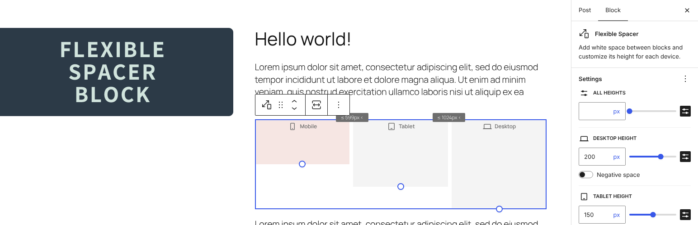
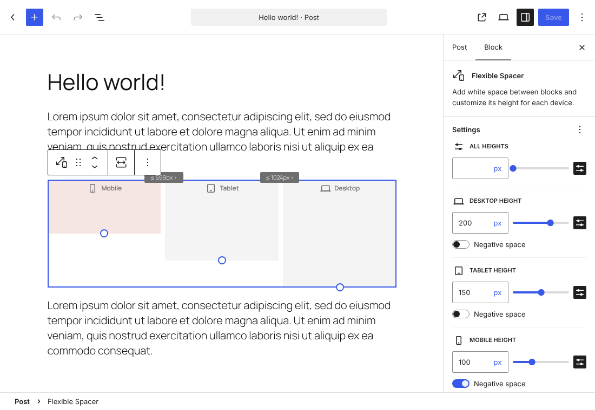
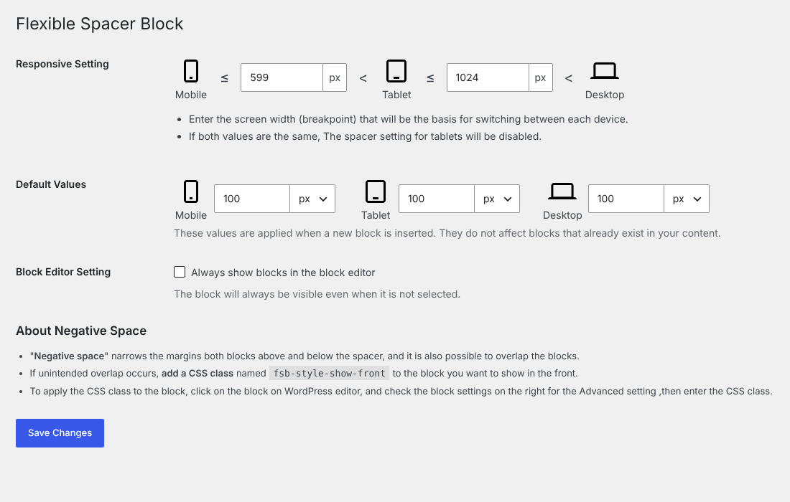
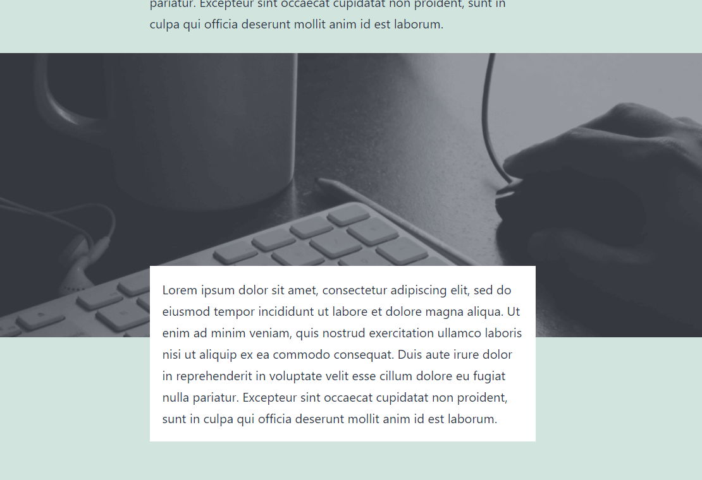
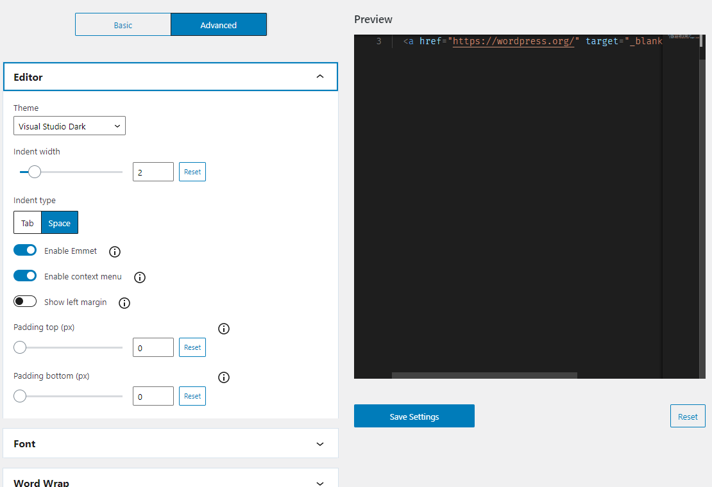

# Flexible Spacer Block

[](https://github.com/t-hamano/flexible-spacer-block/actions/workflows/test.yml)
[](https://github.com/t-hamano/flexible-spacer-block/actions/workflows/deploy.yml)



Flexible Spacer Block switches the height of the spacer according to the device's screen width (breakpoints). This block has two adjustable breakpoints, so you can set a separate spacer height for smartphones, tablets, and desktops. These heights can be changed individually or all at once.

You can also set "negative space (negative margin)" instead of normal space. In addition, the block can be transformed from and to the core Spacer block.

## About negative space

"**Negative space**" reduces the space between the blocks above and below the spacer, and can even make them overlap.

If unintended overlap occurs, add a CSS class named "**fsb-style-show-front**" to the block you want to display in front. To apply the CSS class, select the block in the WordPress editor, open the "Advanced" panel in the block settings sidebar, and enter the class in the "Additional CSS class(es)" field.

## Screenshots






## How to build

```sh
npm install
npm run build
```

## Filters

### `flexible_spacer_block_breakpoint( $breakpoint, $is_editor )`

Filters media query breakpoints.

**Parameters:**

- `$breakpoint`

*(array)* Media query breakpoints (`md` / `sm`).

- `$is_editor`

*(bool)* Whether it is rendered in the editor.

**Return:**

*(array)* New media query breakpoints.

**Example:**

```php
function custom_flexible_spacer_block_breakpoint( $breakpoint, $is_editor ) {
	// Override media query breakpoints.
	return array(
		'md' => 1000,
		'sm' => 500,
	);
}
add_filter( 'flexible_spacer_block_breakpoint', 'custom_flexible_spacer_block_breakpoint', 10, 2 );
```

### `flexible_spacer_block_inline_css( $css, $is_editor )`

Filters generated inline styles.

**Parameters:**

- `$css`

*(string)* Generated inline styles.

- `$is_editor`

*(bool)* Whether it is rendered in the editor.

**Return:**

*(string)* New inline styles.

**Example:**

```php
function custom_flexible_spacer_block_inline_css( $css, $is_editor ) {
	// Override z-index value for negative space on the front end.
	if ( ! $is_editor ) {
		return str_replace( 'z-index:2;', 'z-index:5;', $css );
	}
	return $css;
}
add_filter( 'flexible_spacer_block_inline_css', 'custom_flexible_spacer_block_inline_css', 10, 2 );
```

## Resources

### Image used in screenshots

- License: CC0 Public Domain
- Source: <https://pxhere.com/ja/photo/245>

## Author

[Aki Hamano (GitHub)](https://github.com/t-hamano)
